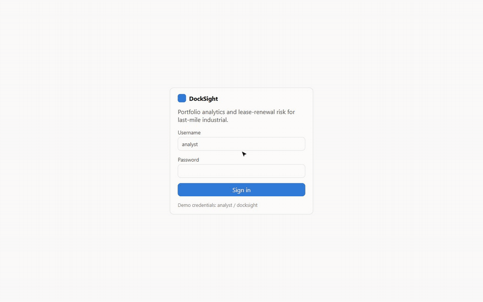
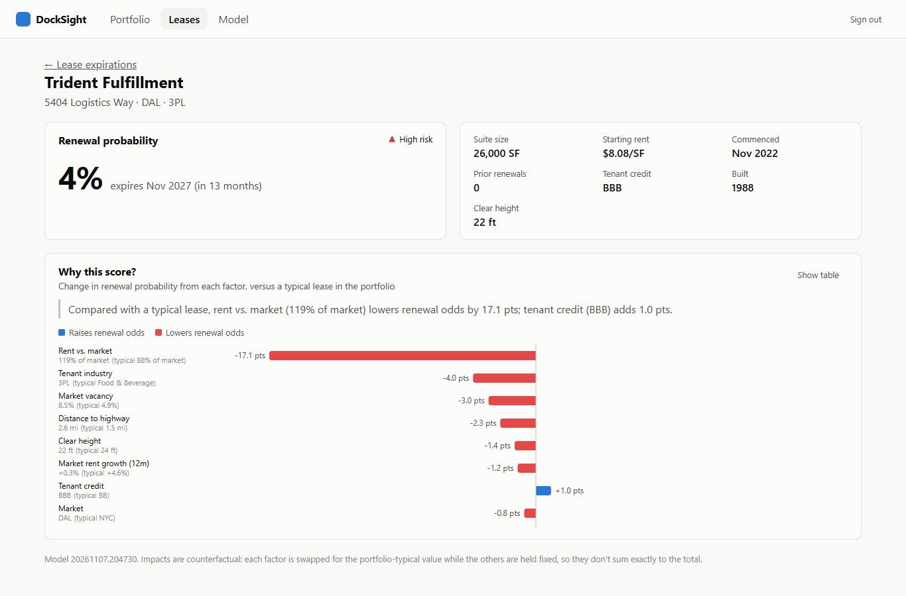
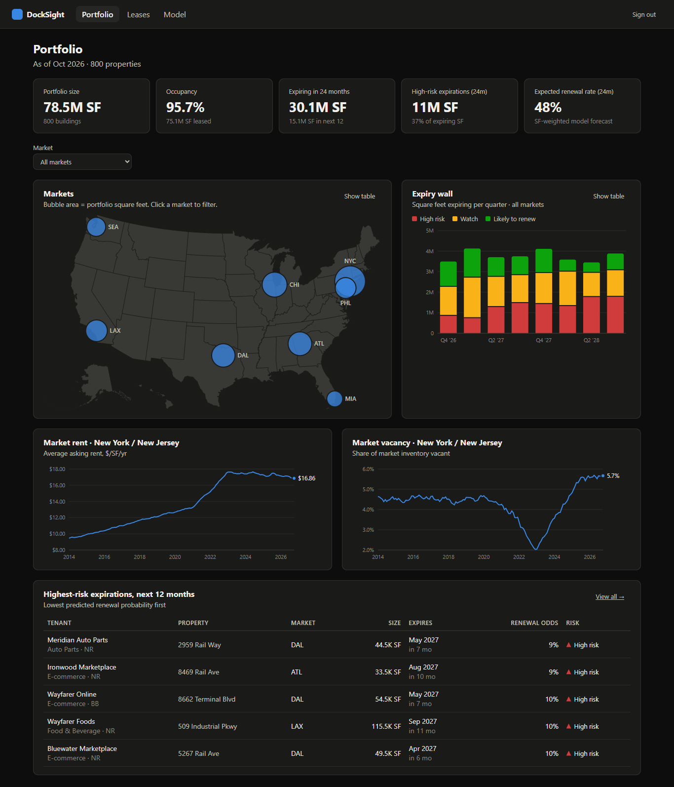
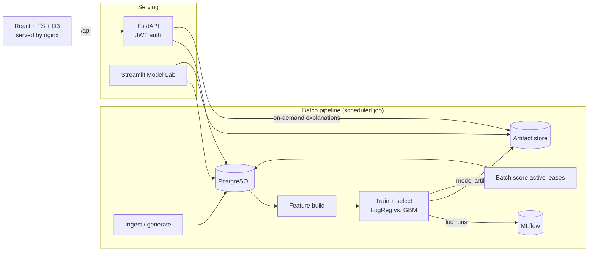

# DockSight

**Portfolio analytics and lease-renewal risk for a last-mile industrial real estate portfolio.**

Owners of logistics warehouses live and die by renewals: every tenant that leaves means months of
downtime, re-leasing costs, and lost rent. DockSight answers the questions an asset manager asks
every Monday:

- *How much square footage rolls in the next two years, and how much of it is at risk?*
- *Which tenants are least likely to renew, and **why**?*
- *How are the markets we're in moving: rent, vacancy?*

It's a full-stack app (React + TypeScript, FastAPI, PostgreSQL) on top of a small ML pipeline
(scikit-learn, MLflow) that predicts renewal probability for each active lease and explains each
prediction in plain language.

**Live demo:** https://docksight-web.grayisland-f5318410.centralus.azurecontainerapps.io
(sign in with `analyst` / `docksight`) · [Model Lab](https://docksight-lab.grayisland-f5318410.centralus.azurecontainerapps.io)
· Hosted on Azure Container Apps and scales to zero, so the first load after a quiet spell takes a few seconds.



<table><tr>
<td></td>
<td></td>
</tr></table>

## Features

| | |
|---|---|
| **Portfolio dashboard** | KPIs, D3 bubble map of markets, the "expiry wall" (SF rolling per quarter by risk band), market rent and vacancy trends |
| **Lease explorer** | Filter, sort, and page through every expiring lease ranked by predicted renewal probability; all filter state lives in the URL |
| **"Why this score?"** | Per-lease drivers chart plus a one-sentence narrative: *"rent vs. market (119% of market) lowers renewal odds by 17.1 pts"* |
| **Model Lab** (Streamlit) | Calibration, score separation, and a what-if simulator for data scientists |
| **Accessible charts** | Every chart has a table view, keyboard focus, and tooltips; status is never encoded by color alone; colorblind-validated palette; dedicated dark mode |

## Architecture



- **One Python package** (`backend/docksight`) holds the pipeline, the ML code, and the API, so
  training and serving share one feature implementation. No training/serving skew.
- **Batch scores, live explanations.** Probabilities are pre-computed into a `predictions` table
  (fast, cheap, auditable); the "why" for a single lease is computed on demand from the same
  feature code.
- **SQL does the aggregation.** KPIs, market rollups, and filters run in the database, not in pandas.

Design decisions are recorded in [`docs/adr/`](docs/adr).

## The model

Predicts whether a tenant renews at lease expiry. Trained on ~2,700 historical expirations.

| | Logistic regression (selected) | Gradient boosting |
|---|---|---|
| Holdout ROC AUC | **0.790** | 0.704 |
| Holdout Brier score | **0.184** | 0.208 |

- **Time-based holdout:** train on leases that expired before July 2024, test on later ones. A
  random split would leak future market regimes into training.
- **Leakage guard:** market features are snapshotted 12 months *before* expiry, when renewal
  conversations actually start, never at the expiry date itself.
- **The holdout picks the winner.** The simpler model won here; with this much data the boosted
  trees overfit. Both runs are logged to MLflow every time.
- **Explanations** use counterfactual substitution: swap one feature to the portfolio-typical value
  and measure the change in probability. It's model-agnostic and explainable to non-technical users.

> The portfolio data is **synthetic**, generated by `docksight/pipeline/generate.py` with a
> realistic market cycle (the 2021-22 e-commerce boom, then the cooldown) and a hidden renewal
> process. Swapping in real data means replacing that one module.

## Running it

**Everything in Docker** (Postgres, pipeline, API, web, Model Lab):

```bash
docker compose up --build
# App:       http://localhost:8080   (analyst / docksight)
# API docs:  http://localhost:8000/docs
# Model Lab: http://localhost:8501
```

**Local development** (SQLite, hot reload):

```bash
# Backend
cd backend
python -m venv .venv && source .venv/bin/activate     # Windows: .venv\Scripts\activate
pip install -e ".[dev,ml,streamlit]"
python -m docksight.pipeline.run                      # generate data, train, score
uvicorn docksight.api.main:app --reload               # http://localhost:8000/docs
streamlit run streamlit_app.py                        # Model Lab

# Frontend (second terminal)
cd frontend
npm install
npm run dev                                           # http://localhost:5173
```

**Azure** (Container Apps, Postgres Flexible Server, Azure Files): `infra/main.bicep`, deployed by
`.github/workflows/deploy.yml` after CI passes on `main`. The workflow builds and pushes both images,
signs in to Azure with OIDC, applies the Bicep, runs the pipeline job, and smoke-tests the live site.
See [ADR 0005](docs/adr/0005-azure-deployment.md).

## Quality

| | |
|---|---|
| Backend | 24 pytest tests: data invariants, leakage guards, model quality floor, API contracts and auth, Streamlit app via `AppTest`; run against **both SQLite and PostgreSQL** in CI; `ruff` lint + format |
| Frontend | Vitest + Testing Library; ESLint; strict TypeScript; Prettier |
| CI | GitHub Actions: backend matrix, frontend checks, then a Docker smoke test that boots the full stack and calls the API through nginx |
| CD | On green `main`: build and push images, apply Bicep, run the pipeline job, smoke-test the live URL |

## Project layout

```
backend/
  docksight/
    pipeline/   generate.py (synthetic data) · io.py · run.py (batch job)
    ml/         features.py · train.py · model.py · explain.py
    api/        main.py · routers.py · schemas.py · security.py
  streamlit_app.py
  tests/
frontend/
  src/
    components/ MarketMap · ExpiryChart · TrendChart · DriversChart (D3 math, React DOM)
    pages/      Dashboard · Leases · LeaseDetail · Model · Login
infra/          main.bicep (Azure Container Apps, Postgres, Azure Files)
docs/adr/       Architecture decision records
```

## Roadmap

- [x] Deploy to Azure: Container Apps + Azure Database for PostgreSQL + Azure Files for artifacts ([ADR 0005](docs/adr/0005-azure-deployment.md))
- [ ] Key Vault for secrets and VNet integration for Postgres
- [ ] Microsoft Entra ID sign-in (MSAL in the SPA, JWKS validation in the API)
- [ ] Kubernetes manifests (AKS) alongside Container Apps
- [ ] PySpark version of the feature job for Databricks
- [ ] Market rent forecasting
